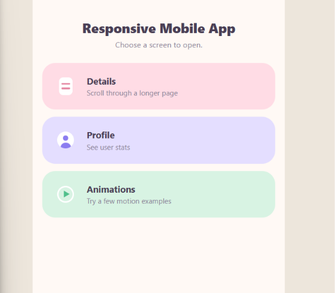
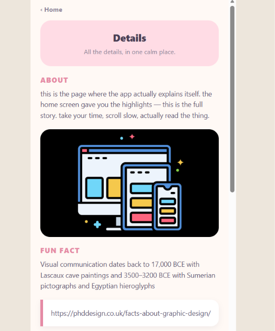
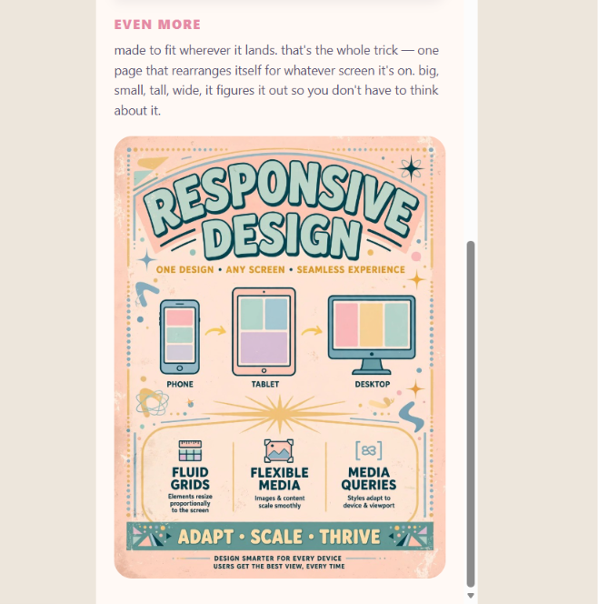
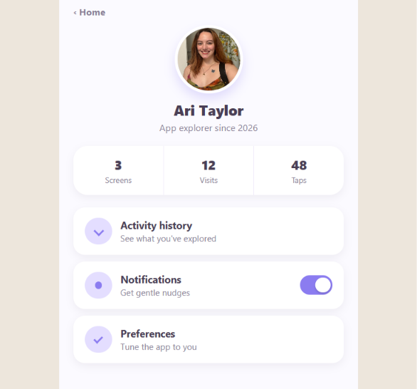
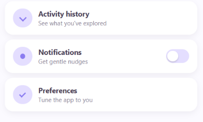
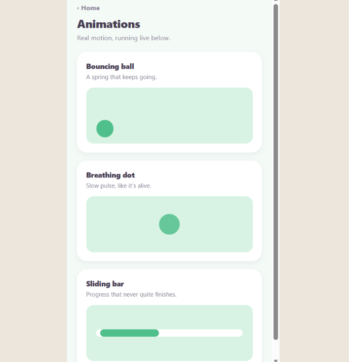

# Responsive Mobile App

Four screens, made with Expo and React Native.

Home is the first page. Three cards open the other screens. Details is a longer page, and the title fades a little as you scroll. Profile has a photo, a few stats, and a notifications switch. Animations plays a bouncing ball, a pulsing dot, and a sliding bar.

The screen files are in `src/app`. One file is one page.

## How to run it

You need Node.js 18 or newer. In a terminal, `node -v` will tell you what you have.

From this folder:

```bash
npm install
npx expo start
```

When the menu shows up, press `w` to open the app in a browser. Leave that terminal running. If you close it, the app stops.

To open it on a phone, install Expo Go and scan the QR code in the terminal. The phone and the computer have to be on the same Wi-Fi.

The iPhone simulator only runs on a Mac. On Windows, use the browser or an Android emulator. `npm run web` opens the browser version without the menu.

## Screenshots

Home.



Details, at the top of the page.



Details after scrolling. The poster sits under Even more.



Profile, with the notifications switch on.



The same switch after it is turned off.



Animations. The bar is partway across, and the ball and dot are in the middle of their loops.


